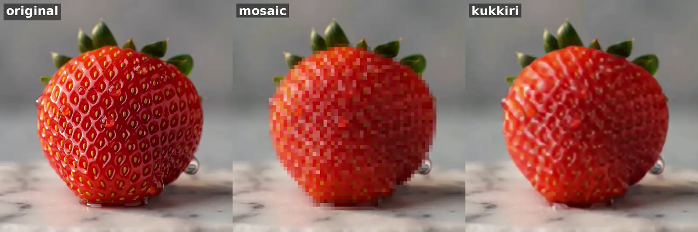

# kukkiri

Restore mosaic-censored video. kukkiri finds the pixelated regions in every frame, tracks them through the scene and
reconstructs what is under them with a video restoration model that uses many frames at once, then writes the result
back into the original video with the source audio.

It runs as one streaming pass on an NVIDIA GPU: decoding, detection, restoration and encoding overlap, and only a
bounded window of frames is ever held in memory, so a two-hour film needs no more memory than a two-minute clip.

[](docs/media/strawberry.mp4)

*Left to right: original, mosaic, kukkiri. An AI-generated clip with a synthetic mosaic; click for the full-quality video.*

## Requirements

- An NVIDIA GTX 16-series / RTX 20-series or newer GPU (compute capability 7.5+) and driver 580 or newer
- Python 3.10+
- `ffmpeg` on the `PATH`

## Install

```
pip install torch torchvision --index-url https://download.pytorch.org/whl/cu130   # match your CUDA
pip install .
```

Or with Docker (Linux, NVIDIA Container Toolkit, driver 580 or newer):

```
docker build -t kukkiri .
docker run --rm --gpus all -v "$PWD:/data" -v "$PWD/weights:/weights" kukkiri \
    restore /data/input.mp4 -o /data/restored.mp4 --weights /weights
```

The image pins the tested versions of the main dependencies. Keep the weights directory mounted writable so the TensorRT
engines built on the first run are reused.

## Weights

The weights are licensed under the same terms as the code (GPL-3.0-only with the NVIDIA exception below).
They are published at [treehog/kukkiri](https://huggingface.co/treehog/kukkiri) on Hugging Face, one folder per version.

The first restore downloads them: the detector (RF-DETR seg-medium, 141 MB, plus its 65 MB ONNX export) and the
restorer (BasicVSR++, 39 MB) as safetensors, checked against the SHA-256 in `kukkiri/weights.py`. They go to a per-user folder
(`%LOCALAPPDATA%\kukkiri\weights\<version>` on Windows, `~/.cache/kukkiri/weights/<version>` elsewhere), or to the folder in
`KUKKIRI_WEIGHTS` or `--weights`. The Windows app downloads them the same way on first use. To fetch them ahead of time:

```
kukkiri download-weights [folder]
```

TensorRT engines are built into the same folder on the first run, which takes a few minutes and is cached afterwards.

## Usage

```
kukkiri restore input.mp4 -o restored.mp4
```

Before restoring, kukkiri samples the file's keyframes and skips inputs with nothing to restore: videos that are
already uncensored, copies another tool has already processed, or footage with no censoring at all. Pass
`--skip-check` to restore anyway.

Output keeps the source resolution. `--max-1080p` serves larger sources (4K) at 1080p instead, which is faster and
gives smaller files.

To restore many videos, pass several files and/or folders (folders are searched recursively) and an output folder:

```
kukkiri restore movies/ extra.mkv -o restored/
```

Files are restored one after another; a file that is declined or fails is reported and the batch goes on, with a
summary at the end. Earlier kukkiri outputs (`*.kukkiri.mp4`) in those folders are left out.

To restore only part of a video, for example a 30-second preview:

```
kukkiri restore input.mp4 -o section.mp4 --start 37:45 --duration 30
```

The section is cut frame-accurately before restoring and the output contains only that section. The input check is
skipped for sections.

Inputs in containers or codecs the GPU decoder cannot read directly (AVI, WMV, MPEG-TS, MPEG-PS, ...) are first
remuxed or re-encoded to H.264 MP4 automatically.

## Desktop app

```
pip install ".[gui]"
kukkiri-gui
```

Add videos or whole folders with the buttons or by dropping them on the window, choose the weights folder once, and press Start.
Files are restored one after another; each row shows its progress and time left, and a finished row opens on
double-click. Start and Duration apply to files added after they are set, for restoring a section only. Stop ends the
current file (its partial output is removed) and pauses the rest of the queue.

## How it works

1. **Detect.** An RF-DETR segmentation model marks mosaic regions in every frame.
2. **Track.** Overlapping detections are merged into regions and followed through the scene; short misses are
   bridged by interpolation.
3. **Restore.** Each region is cut out as a square window with a little context, scaled onto the model's canvas and
   restored in clips of 96 frames by BasicVSR++. Neighbouring clips overlap and are crossfaded, so there are no seams.
4. **Blend.** The restored region is feathered back into the frame just past the detected area, and the video is
   encoded on the GPU.

## Limitations

- Pixelated faces (identity mosaics) are recognised as such and left as they are; kukkiri never restores them.
- Content that another tool has already "decensored" into smooth shapes cannot be recovered; the input check
  declines such files instead.

## License

Copyright (c) 2026 kukkiri authors. The code is licensed under the GNU General Public License v3.0 only
(`LICENSE`); the vendored BasicVSR++ code keeps its Apache-2.0 license (`licenses/APACHE-2.0.txt`). Third-party
components and their licenses are listed in `NOTICE.md`. The model weights are released under the same license.
`LICENSE-EXCEPTION.md` grants an additional permission to combine kukkiri with NVIDIA's CUDA, TensorRT and Video
Codec SDK libraries. The kukkiri name and logo are not covered by the license; see `CONTRIBUTING.md`.

## Acknowledgements

- [Lada](https://github.com/ladaapp/lada), for showing what open mosaic restoration can do
- [BasicVSR++](https://arxiv.org/abs/2104.13371) (Chan et al., CVPR 2022), via OpenMMLab's
  [MMagic](https://github.com/open-mmlab/mmagic): the restoration network
- Roboflow's [RF-DETR](https://github.com/roboflow/rf-detr): the detector
