# kukkiri on Windows

The Windows installer contains everything kukkiri needs: Python, PyTorch, TensorRT and ffmpeg. You do not need to
install anything else apart from an up-to-date NVIDIA driver.

## Requirements

- Windows 10 or 11, 64-bit
- An NVIDIA GTX 16-series / RTX 20-series or newer GPU, with driver 580 or newer
  ([nvidia.com/drivers](https://www.nvidia.com/drivers))
- About 6 GB of free disk space, plus room for the restored videos

## Install

Download [kukkiri-setup.exe](https://huggingface.co/treehog/kukkiri/resolve/main/windows/kukkiri-setup.exe) (about 3 GB; it always holds the latest release) and run it. It installs for your user only, so it does not ask for administrator rights. If Windows SmartScreen
says it protected your PC, click **More info**, then **Run anyway**.

Accept the license (GPL-3.0) and click **Next**.


kukkiri installs into `%LOCALAPPDATA%\Programs\kukkiri`. Keep that folder unless you have a reason to change it.

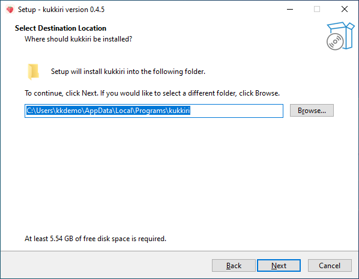

On the next page you can add a desktop shortcut. Then click **Install**. Unpacking takes a few minutes. When it
finishes, leave **Start kukkiri** ticked and click **Finish**.

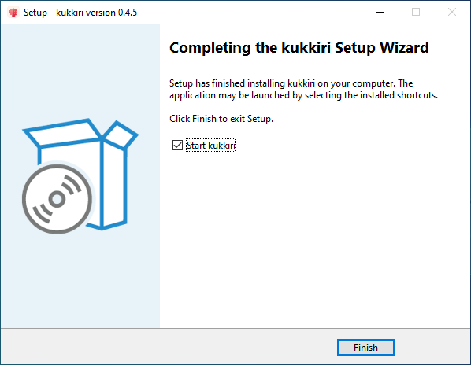

Later, start kukkiri from the Start menu.

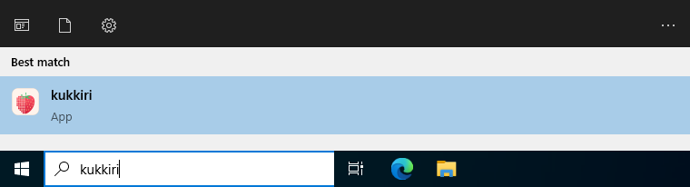

## The window

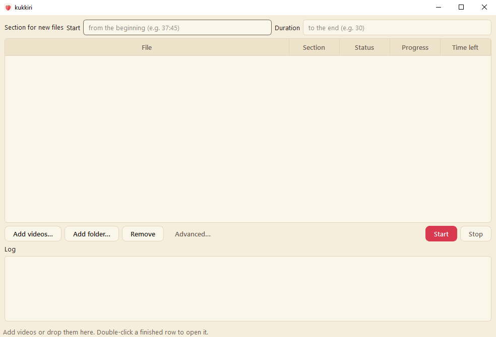

kukkiri works through a queue. You add videos, press **Start**, and they are restored one after another. Each
restored video is saved as a new file next to the original; the original is never changed.

## Add videos

Click **Add videos…** and pick one or more files, or drag them onto the window. **Add folder…** adds every video in
a folder and its subfolders; files kukkiri restored earlier are left out.

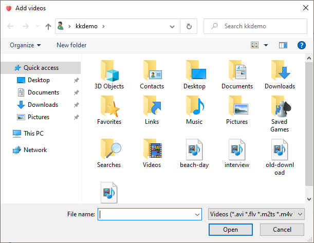

kukkiri reads MP4, MKV, MOV, AVI, WMV, TS, M2TS, MPG, M4V, WebM and FLV. Formats the GPU cannot decode directly are
converted to MP4 automatically before restoring.

Each video becomes a row in the queue.

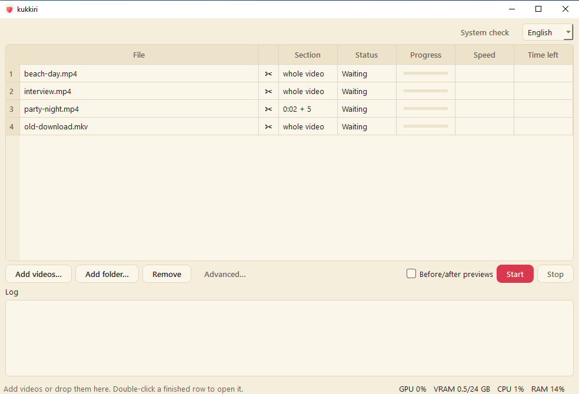

To take a video out of the queue, select its row and click **Remove**.

## Restore only part of a video

To restore only a section, for example to try kukkiri on a short scene first, fill in **Start** and **Duration**
*before* adding the video. Both take seconds, `mm:ss` or `hh:mm:ss`. Leave Duration empty to restore from Start to
the end.

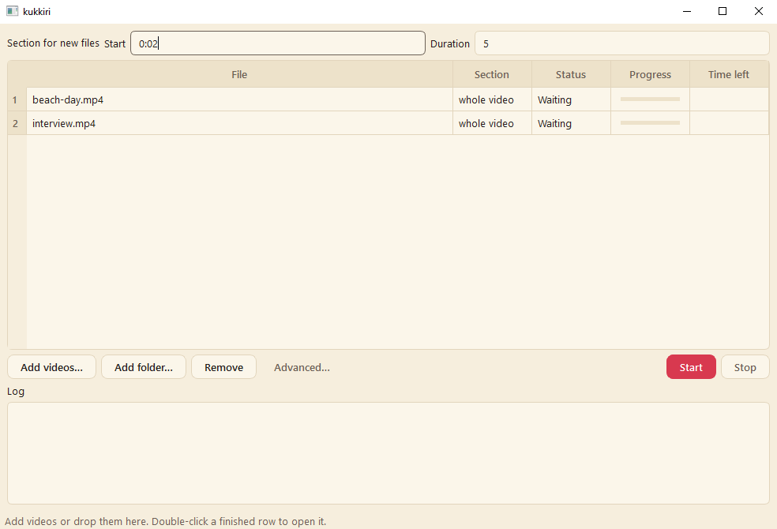

The values apply to every video you add while they are set. The **Section** column shows what each row will
restore.

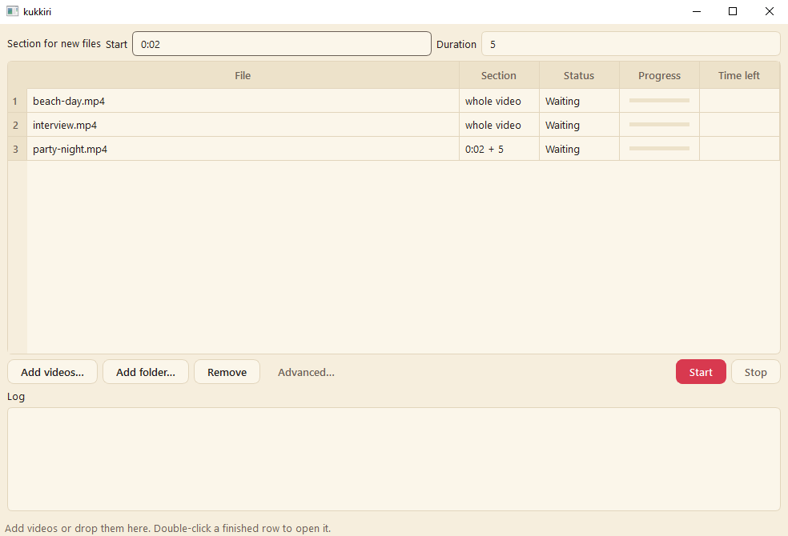

Clear the two fields again before adding more whole videos.

## Advanced

**Advanced…** shows three more settings, which kukkiri remembers:

- **Model:** which kiyo model restores, by default the latest (`kiyo-v4`). An older one (`kiyo-v3`) is there for
  comparison; it is downloaded the first time you use it.
- **Weights folder:** where the models are kept, by default `%LOCALAPPDATA%\kukkiri\weights\<version>`. Change it
  only if you keep the models somewhere else.
- **Output folder:** where restored videos go. Empty means next to each original.


## Restore

Click **Start**.

The very first time, kukkiri downloads its models (about 240 MB; it asks first) and then prepares them for your
GPU. This preparation takes 10 to 20 minutes, during which the first video stays at **Starting** with no progress.
It happens once; every later run starts within seconds.

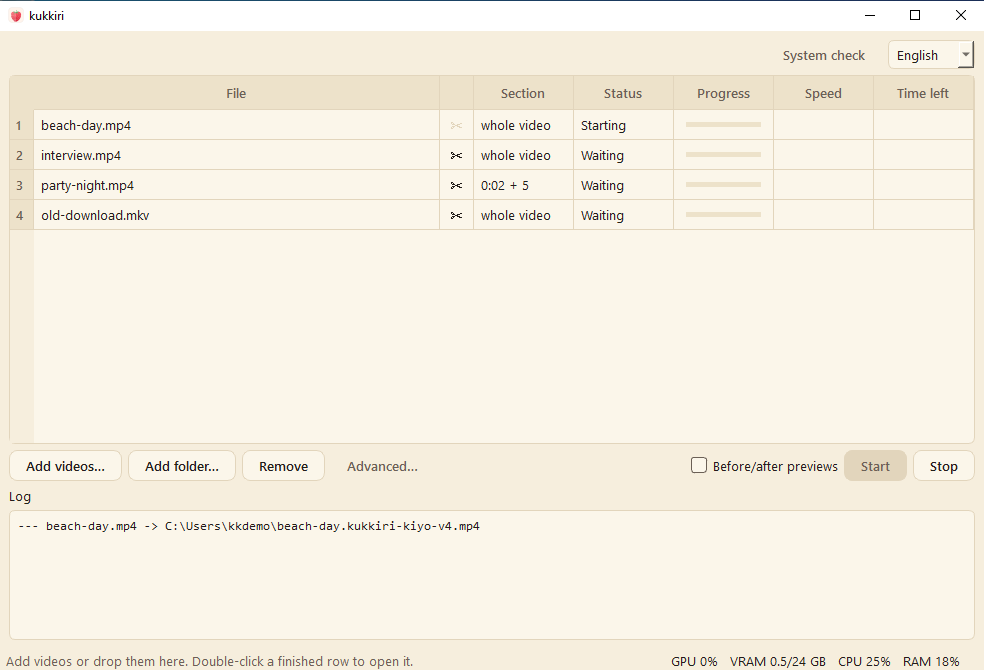

Before restoring a video, kukkiri checks a few frames from across it. A video that is not censored, or one that
another tool has already "decensored" into smooth shapes, is skipped with the reason in its Status.

While a video is restoring, its row shows the progress and the time left.

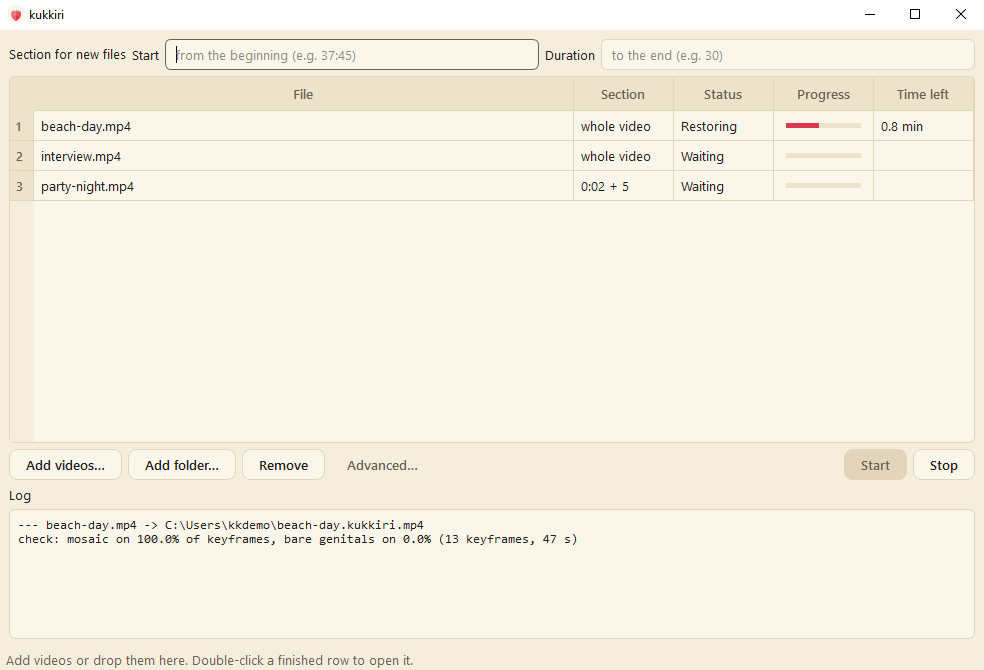

When the queue is done, every row says **Done** and the status bar says *Queue finished.* Double-click a finished
row to play the restored video.

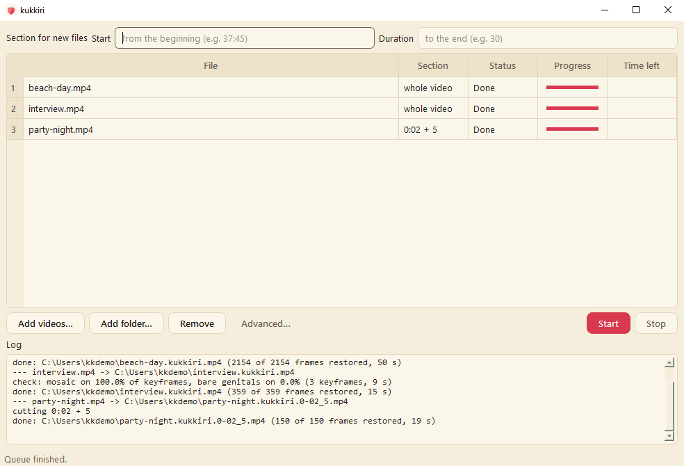

## The restored files

Restored videos are named after the original plus `.kukkiri` and the model that restored them: `beach-day.mp4`
becomes `beach-day.kukkiri-kiyo-v4.mp4`. A section also carries its start and duration, so `party-night.mp4` restored
from 0:02 for 5 seconds becomes `party-night.kukkiri-kiyo-v4.0-02_5.mp4`. (The screenshot below is from an earlier
version, before the model was part of the name.)

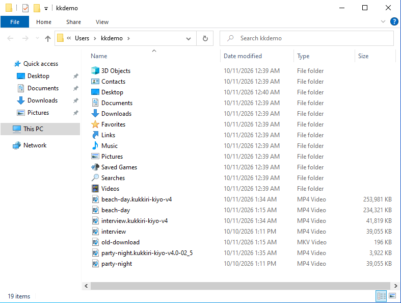

The restored video keeps the original's resolution, frame rate and audio. Pixelated faces are recognised as such and
always left as they are.

## Before/after previews

Tick **Before/after previews** (next to **Start**) to also get up to three 30-second side-by-side clips of each
video: the original on the left, the restored video on the right, from the moments with the most restoration. They
are saved next to the restored video as `<name>.kukkiri-kiyo-v4.preview-<start>.mp4`, carry a small kukkiri
watermark in the top right corner and have no sound, ready to share. The restored video itself never has a watermark.

## Stop, and files that fail

**Stop** ends the video being restored, deletes its unfinished output and pauses the queue. The rest of the queue
stays **Waiting**; click **Start** to continue.

If a file cannot be read, for example because it is damaged or not really a video, its row says **Failed** and the
**Log** below the queue explains why. The queue carries on with the next video.

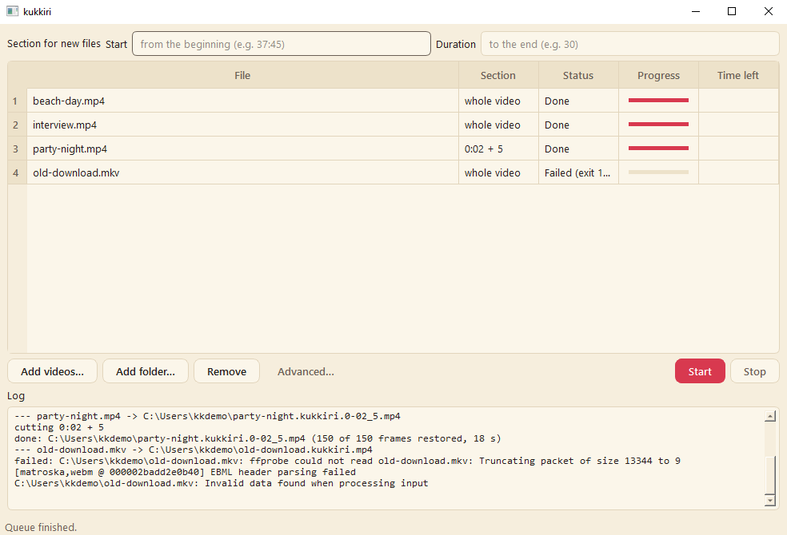

## Command line

The installer also includes the command-line version, `kukkiri.cmd`, in the install folder. Open a Command Prompt
and run, for example:

```
"%LOCALAPPDATA%\Programs\kukkiri\kukkiri.cmd" restore "C:\Videos\beach-day.mp4"
```

It uses the same models as the app, so nothing is downloaded or prepared twice. `restore --help` lists every option;
the [README](../README.md#usage) explains them.

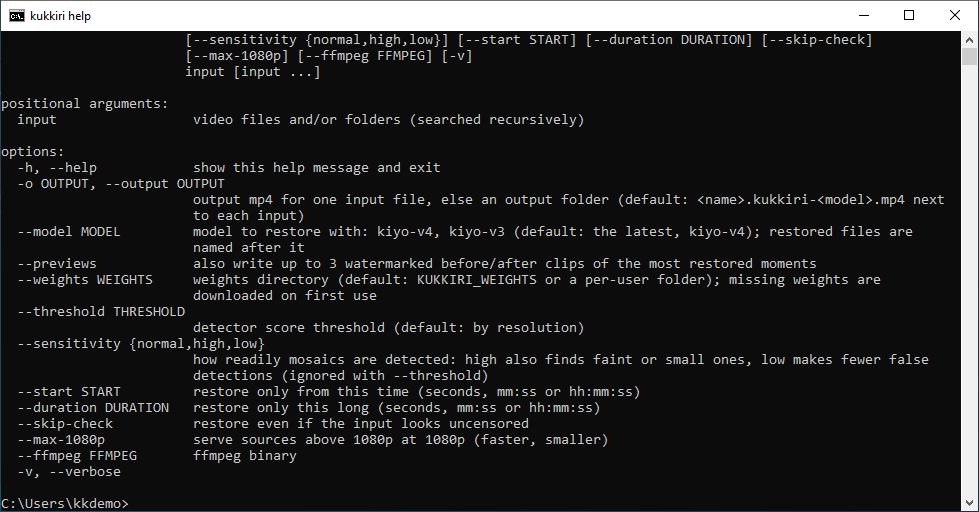

## Uninstall

Open **Settings → Apps**, find **kukkiri** and click **Uninstall**. This removes the program; your restored videos
are not touched. The models and their GPU files stay in `%LOCALAPPDATA%\kukkiri`, so a reinstall does not download
them again. Delete that folder to remove them as well.

## Problems

- **"no NVIDIA GPU found" or "driver … which kukkiri cannot use":** update the NVIDIA driver to 580 or newer from
  [nvidia.com/drivers](https://www.nvidia.com/drivers) and restart.
- **"(GPU) is not supported":** kukkiri needs a GTX 16-series / RTX 20-series or newer card.
- **The first video sits at Starting for a long time:** that is the one-time GPU preparation described above.
- Anything else: the **Log** panel has the details. Please include it when you
  [report an issue](https://github.com/treehog2/kukkiri/issues).
